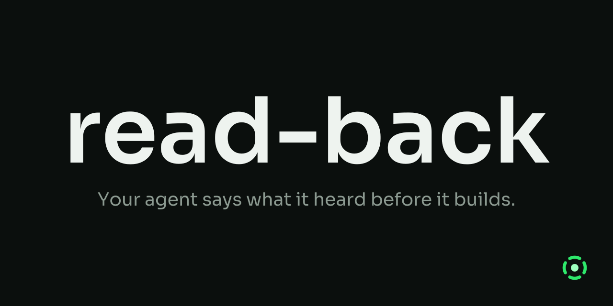

<p align="center">
  
</p>

# read-back

`read-back` is an agent skill that makes your coding agent tell you what it heard before it builds anything.

Agents start building the moment you hit enter. If they misread the prompt, you find out twenty files later. Dictated prompts make this worse: "Redis" comes through as "reddish", and the agent goes looking for a library called reddish. Examples cause trouble too. Write "exempt the health check and webhooks" and the agent either treats those two as the complete list or ignores them.

With `read-back`, the agent answers your prompt with a short summary of what it understood, the way a pilot reads back a clearance. You confirm or correct it, and only then does work start.

Here's a dictated prompt:

```
/read-back add rate limiting to the public API, something like 100 requests a
minute per key, return a 429 with a retry after header. put it in the middleware
not in each route. and the health check and web hooks should be exempt. use the
reddish client we already have
```

And the read-back:

> **Intent** — Cap how often each API key can call the public API, enforced once in middleware.
>
> **Direction**
> 1. Add a rate-limit middleware keyed on API key, 100 requests per minute.
> 2. Store the counters through the existing Redis client.
> 3. Over the limit, return 429 with a Retry-After header.
> 4. Mount it once on the public API router, not per route.
> 5. Skip limiting for the health check and webhook routes.
>
> **Extending** — exempt infrastructure endpoints → also `/status`, `/metrics` and the readiness probe<br>
> **Leaving alone** — auth, the internal admin API, per-route limits<br>
> **From earlier context** — nothing<br>
> **Unclear** — "reddish client" read as "Redis client". Requests with no API key: I'd limit them by IP at the same rate.
>
> Go, correct me, or cancel?

The agent flags the misheard word instead of guessing. It treats your two exemptions as examples of a pattern and proposes more of the same kind. You see all of this before any code exists.

## Using it

Put `/read-back` in front of any prompt. If you run it with no text, it reads back your previous message.

Then reply with one of:

- **Go**: the agent does exactly what the read-back says, including the Extending items.
- **Go, without extending**: same, but your examples stay as you wrote them.
- **A correction**: the agent folds it in and gives you a fresh read-back.
- **Cancel**: the agent drops the read-back and does nothing. "Scrap" and "start over" work too.
- **Cancel, keep the prompt**: the agent throws away its reading and reads back your latest prompt again from scratch.

Read-backs stack. If you send another `/read-back` before saying Go, the new one merges everything still open into one list, and flags anything you changed. Saying Go or Cancel closes the chain, and the next read-back starts fresh.

You type `/read-back` everywhere. Claude Code namespaces plugin skills, so if you installed it as a plugin the command list may show it as `/read-back:read-back`.

## What it won't do

- Read files, run searches or edit anything while building the read-back. It works only from your prompt. A reference it can't resolve without looking goes under Unclear.
- Start work before you say Go, or after you say Cancel.
- Run on its own. It only runs when you type the command.

## Install

The skill is a single SKILL.md file in the open Agent Skills format, so it works in Claude Code, Codex, Gemini CLI, Copilot, Cursor and most other coding agents. The quickest way, for any agent:

```
npx skills add Omnixenon/read-back
```

It asks which agents to install for. Add `-g` for a user-wide install, or `-a <agent>` to pick one agent.

Claude Code also takes it as a plugin, inside a session:

```
/plugin marketplace add Omnixenon/read-back
/plugin install read-back@read-back
```

Auto-update is off by default for third-party marketplaces. You can turn it on under `/plugin` > Marketplaces. Pick either the plugin or `npx skills` for Claude Code, not both, or you'll get the skill twice.

<details>
<summary>Other agents</summary>

**Codex** reads Claude plugin marketplaces:

```
codex plugin marketplace add Omnixenon/read-back
codex plugin add read-back@read-back
```

**Gemini CLI**

```
gemini skills install https://github.com/Omnixenon/read-back.git --path skills/read-back
```

**GitHub Copilot**

```
gh skill install Omnixenon/read-back read-back
```

**OpenCode, Cursor, Windsurf, Amp**

```
npx skills add Omnixenon/read-back -a opencode   # or cursor, windsurf, amp
```

**Goose**: copy the folder by hand (below). `npx skills -a goose` writes to `~/.config/goose/skills/`, and current Goose docs don't list that path.

**Manual copy** works for every agent above:

```
git clone https://github.com/Omnixenon/read-back /tmp/read-back
cp -r /tmp/read-back/skills/read-back ~/.claude/skills/   # Claude Code
cp -r /tmp/read-back/skills/read-back ~/.agents/skills/   # everything else
```

</details>

Only install read-back from `Omnixenon/read-back` on GitHub. The skill is one Markdown file with no scripts or binaries. If a copy ships either, it isn't ours.

## About

Made by [Omnixenon](https://github.com/Omnixenon).

MIT licensed, see [LICENSE](LICENSE). Issues and pull requests are welcome, and so are reports of a read-back that got something wrong.
